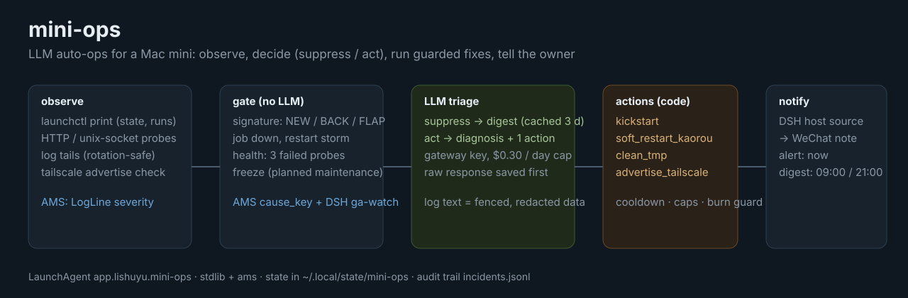

# mini-ops

A Mac mini that runs your pipelines unattended will fail at 3 a.m. in ways a restart policy cannot judge:
a service is down but a render is in flight, a warning is noise today and an outage tomorrow, a
login-wall error repeats 1,400 times. **mini-ops watches the box, asks a cheap LLM whether each
anomaly is noise or needs handling, runs a short list of guarded fixes, and tells you either way** --
one WeChat message when it acted, one digest (09:00 / 21:00) for everything it chose to ignore.

- **Quiet by construction.** A deterministic gate (new / back after silence / flapping) runs before any
  model call, and a "suppress" verdict is remembered for 3 days. Replayed over eight days of the
  busiest log we have (13,747 escalations) the gate opens 341 incidents, which is 58 distinct causes.
- **Acts, within limits.** The model can only *name* an action from a closed list; code decides whether
  it runs (cooldown, daily and hourly caps, freeze, and the rule that a Kaorou subtitle burn is never
  interrupted). Changing code is not on the list -- that is a diagnosis plus advice.
- **Cheap and capped.** `deepseek-flash` through the owner's LLM gateway, a gateway key limited to
  USD 0.30/day, plus a local daily cap on calls and dollars. Every paid response is written to disk
  before it is parsed.
- **Auditable.** One JSON line per decision in `incidents.jsonl` (AMS's escalation journal format).

## What it watches (this Mac mini)

| id | what | signals | actions |
|---|---|---|---|
| `kaorou-daemon` | pipeline worker | launchd state, restart storm, `daemon.err.log` | `soft_restart_kaorou` (drains; refused while any job runs or ffmpeg exists) |
| `kaorou-api` | panel + REST | launchd, `/healthz`, `api.err.log` | `kickstart` |
| `kaorou-cookies` / `-potoken` | cookie refresh / PO-token server | last exit code, `/ping`, log `ERR` lines | -- |
| `asr` | speech recognition service (runs through tcc-host) | launchd, `/health`, stderr log | `kickstart` |
| `chrome-cookie-proxy` | cookie export helper | launchd, socket connect, HTTP status in its log | `kickstart` |
| `tcc-host` | TCC launcher | `deny` / `fail` lines | -- |
| `dsh-events` | DSH event service (system domain) | launchd, `/` answers 401, **stderr only** | -- (observe; others deploy it) |
| `tailscale` | Tailscale Services | `AdvertiseServices` in prefs | `advertise_tailscale` |

## Install / operate

```bash
uv venv --python 3.13 .venv && uv pip install -e '.[dev]'     # pulls ams at a pinned commit
cp deploy/ops.toml ~/.config/mini-ops/ops.toml                 # then put llm-key and host-token next to it (0600)
.venv/bin/mini-ops check                                       # config + credential files
.venv/bin/mini-ops test-notify                                 # one real message through DSH
cp deploy/app.lishuyu.mini-ops.plist ~/Library/LaunchAgents/
launchctl bootstrap gui/$(id -u) ~/Library/LaunchAgents/app.lishuyu.mini-ops.plist
```

| | |
|---|---|
| status | `mini-ops status` (job states, LLM spend, freezes, recent actions) |
| planned maintenance | `mini-ops freeze add <id\|*> 2h "why"` -- no actions, incidents muted into the digest; `--keep-alerts` still notifies; `freeze rm <id>` |
| dry run | `mode = "dry-run"` in `ops.toml`: triage and notify, never act |
| logs | `~/.local/state/mini-ops/logs/mini-ops.log` (rotated), `incidents.jsonl`, raw LLM responses under `raw/` |
| **stop** | `launchctl bootout gui/$(id -u)/app.lishuyu.mini-ops` (nothing depends on it) |
| **remove** | stop, delete the plist, revoke the gateway key (`DELETE /llm/api/keys/<id>`), delete `~/.config/mini-ops` |

## How a decision is made

```
observe  → gate (NEW / BACK / FLAP, job down 2 ticks, restart storm, 3 failed probes)
         → frozen & muted? → digest
         → cached "suppress" verdict (3 d)? → digest
         → LLM triage  ── suppress → digest (+ remembered)
                       └─ act → [one allow-listed action, if guards pass] → alert now
LLM unavailable / over budget → job & health incidents alert raw; log lines wait for the digest
```

Notifications go to DSH's `lsy-event-ingest` as `host.ops.*` events (the same `host` source the
disk watcher uses); its `host-alerts` subscription turns them into a plain WeChat note. That note
carries **subject and title only**, so the whole message is composed into a one-line title.
The WeChat reply window is shared with everything else DSH says, hence the caps (2/hour, 6/day).

## Reuse

AMS (`agent-managed-services`): log severity (`LogLine.classify`), cause keys, the journal writer.
DSH's `ga-watch` operator script: the signature + NEW/BACK/FLAP gate and its baseline pass.
`api` llm-ops: failure classes with a minimum occurrence count, per-day attempt caps, evidence kept with
the report. Why this is a separate tool and not an AMS mode: `docs/design.md`.

## Tests

`.venv/bin/python -m pytest -q` (107 tests, ~2 s). Everything outside the process (launchctl, HTTP, the
LLM, DSH, the clock) is injected, so the whole tick is tested with fakes.
